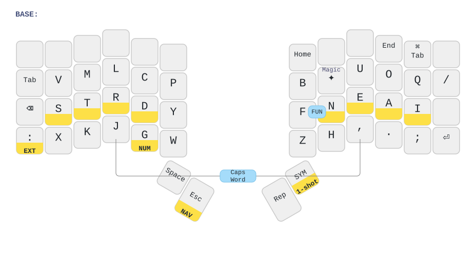
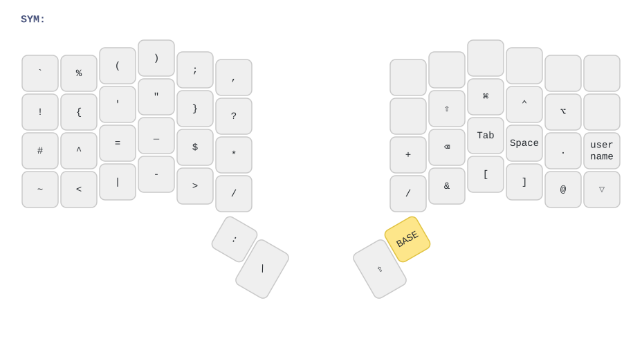
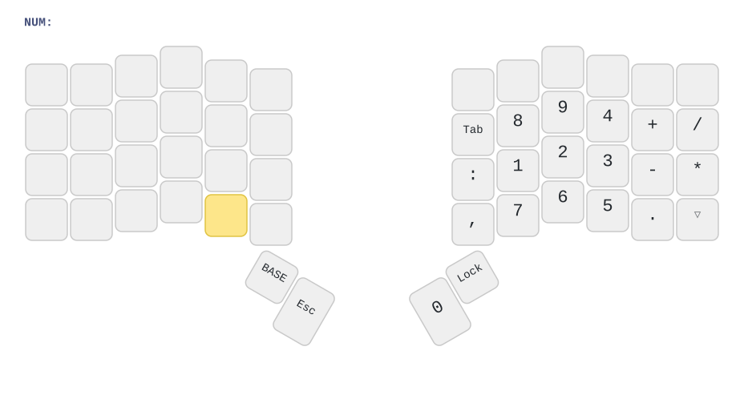
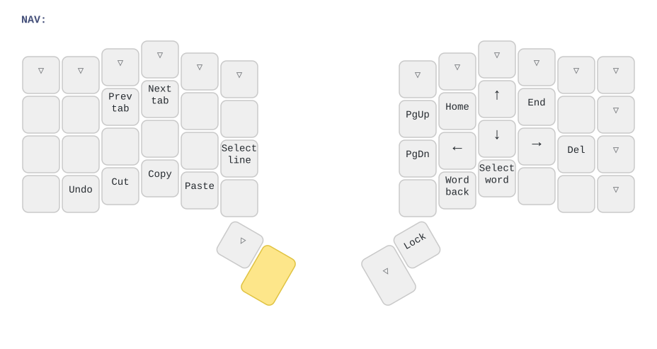
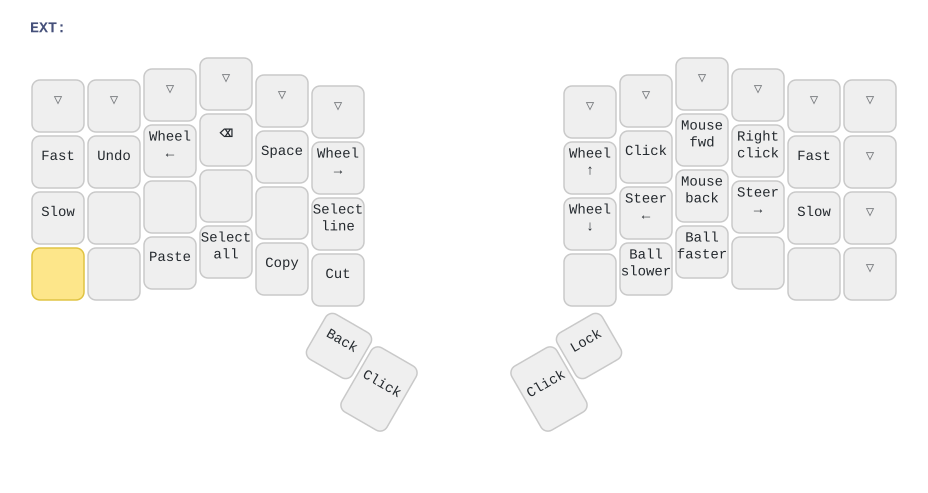
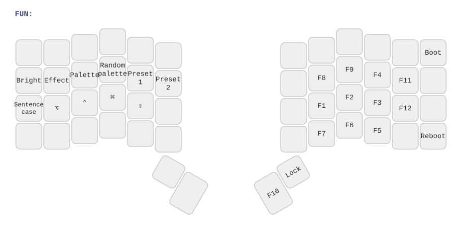

# lakes26's QMK keymap for the ZSA Voyager

My [QMK](https://docs.qmk.fm) keymap for the [ZSA Voyager](https://www.zsa.io/voyager),
kept as a [QMK External Userspace](https://docs.qmk.fm/newbs_external_userspace).
It is based on [@getreuer's keymap](https://github.com/getreuer/qmk-keymap) and
uses his [community modules](https://github.com/getreuer/qmk-modules).

## Layers

The diagrams are drawn from the keymap with
[keymap-drawer](https://github.com/caksoylar/keymap-drawer) (see
[Regenerating the diagrams](#regenerating-the-diagrams)). The yellow band at the
bottom of a key shows what it does when held, the yellow key is the one held to
reach that layer, and ▽ passes through to the layer below.

### BASE

[Magic Sturdy](https://github.com/Ikcelaks/keyboard_layouts) with home row mods
(⌥ ⌃ ⌘ ⇧ = Alt, Ctrl, Cmd, Shift). ✦ is the Magic key (Alt Repeat) and Rep the
Repeat key.



- Hold `:` for **EXT**, G for **NUM**, Esc for **NAV**. **SYM** is one-shot:
  the next key comes from SYM (hold it to stay on SYM).
- Combos: **J + ,** toggles Caps Word; **F + N** opens the one-shot **FUN**
  layer.
- Key overrides: Shift + `,` = `!`, Shift + `.` = `?`, Shift + `/` = `\`,
  Shift + ⏯ = next track.
- ⌘ Tab is an app switcher with
  [Cyclotab](https://github.com/getreuer/qmk-modules/tree/main/cyclotab): tap
  repeatedly to cycle; the next key press completes the switch.

### SYM (one-shot)



### NUM (hold G)



### NAV (hold Esc)



- Undo / Cut / Copy / Paste send Cmd shortcuts on macOS and Ctrl elsewhere,
  using QMK OS detection.
- [Select Word](https://github.com/getreuer/qmk-modules/tree/main/select_word):
  Select word / Word back / Select line; press repeatedly to extend. Magic after
  it reverses the direction.

### EXT (hold `:`): mouse



- [Orbital Mouse](https://github.com/getreuer/qmk-modules/tree/main/orbital_mouse):
  Mouse fwd / back move along the current heading, Steer ← / → turn it, Fast /
  Slow change the speed.
- Select all / Back (browser back) also follow the host OS.

### FUN (F + N, one-shot)



- Bright cycles the lighting brightness off / 40% / 100%
  ([Lumino](https://github.com/getreuer/qmk-modules/tree/main/lumino)). Effect /
  Palette step through [PaletteFx](https://github.com/getreuer/qmk-modules/tree/main/palettefx)
  effects and palettes (hold Shift to go back); Random palette and Preset 1 / 2
  pick one directly.
- Sentence case toggles
  [Sentence Case](https://github.com/getreuer/qmk-modules/tree/main/sentence_case),
  which capitalizes the first letter of each sentence.
- Boot enters the bootloader for flashing; Lock is Layer Lock (60 s idle
  timeout).

### Status LEDs

| LED | Meaning |
|---|---|
| 1 (left, top) | A layer other than BASE is active (incl. a pending one-shot) |
| 2 (left, bottom) | Sentence Case will capitalize the next letter |
| 3 (right, top) | Caps Word is on |
| 4 (right, bottom) | A layer is locked |

### Tap-hold settings

Same approach as getreuer ([config_lakes26.h](config_lakes26.h),
[lakes26.c](lakes26.c)):

- 240 ms tapping term (195 ms for the Shift keys D and N).
- Chordal Hold: a home row mod only acts as a modifier when the next key is on
  the other hand.
- Permissive Hold.
- Flow Tap: no mods during fast typing.
- Speculative Hold: mods apply instantly, so Cmd/Shift + click don't lag.

## Files

| Path | Purpose |
|---|---|
| `qmk.json` | Build targets (`zsa/voyager:lakes26`) |
| `keyboards/zsa/voyager/keymaps/lakes26/keymap.c` | The layers and the Chordal Hold handedness map |
| `keyboards/zsa/voyager/keymaps/lakes26/keymap.json` | Community modules to enable |
| `keyboards/zsa/voyager/keymaps/lakes26/layout.h` | `LAYOUT_LR` macro (left half, then right half) |
| `keyboards/zsa/voyager/keymaps/lakes26/config.h`, `rules.mk` | Voyager-specific settings; include the shared ones below |
| `lakes26.c` | Keycodes, combos, key overrides, tap-hold callbacks, Magic key, macros, RGB, LEDs |
| `config_lakes26.h`, `rules.mk` | Shared feature configuration |
| `palettefx_user.inc` | Custom PaletteFx palettes |
| `modules/getreuer` | Submodule: [getreuer/qmk-modules](https://github.com/getreuer/qmk-modules) |
| `doc/` | Keymap diagrams (generated; see below) |
| `tools/draw_keymap.sh`, `tools/keymap_drawer/` | Diagram generator |

## Building and flashing

Clone with `git clone --recurse-submodules`, or run
`git submodule update --init` in an existing clone.

- **GitHub Actions:** every push builds the firmware and publishes
  `zsa_voyager_lakes26.bin` under Releases. The QMK version is pinned in
  [.github/workflows/build_binaries.yaml](.github/workflows/build_binaries.yaml).
- **Locally:** set up QMK (`curl -fsSL https://install.qmk.fm | sh`), check out
  the same QMK version (`git -C ~/qmk_firmware checkout 0.34.7 && qmk git-submodule`),
  then in this directory run `qmk config user.overlay_dir="$(realpath .)"` and
  `qmk compile -kb zsa/voyager -km lakes26`.

Flash the `.bin` with [Keymapp](https://www.zsa.io/flash). To enter the
bootloader, use the reset pinhole or press **F + N**, then **Boot** (top right).

## Regenerating the diagrams

The SVGs in `doc/` are drawn from `keymap.c` by
[keymap-drawer](https://github.com/caksoylar/keymap-drawer). After changing the
keymap, run:

```sh
pipx install keymap-drawer   # once (or: pip3 install keymap-drawer)
tools/draw_keymap.sh
```

The pieces live in [tools/keymap_drawer/](tools/keymap_drawer):

- `keymap_to_json.py` converts `keymap.c` to QMK keymap JSON. (`qmk c2json`
  can't parse it because of `LAYOUT_LR` and the `#include "lakes26.c"`.)
- `config.yaml` sets the key labels and colors.
- `combos.yaml` lists the combos by key position, since keymap-drawer can't
  read them from C. Update it when adding a combo.
- `postprocess.py` enlarges single-character legends and adds the yellow hold
  bands.

## License

The userspace template is from [qmk/qmk_userspace](https://github.com/qmk/qmk_userspace)
(GPL-2.0, see [LICENSE](LICENSE)). Code adapted from
[getreuer/qmk-keymap](https://github.com/getreuer/qmk-keymap) is Copyright
Google LLC and licensed under the
[Apache License 2.0](https://www.apache.org/licenses/LICENSE-2.0).
